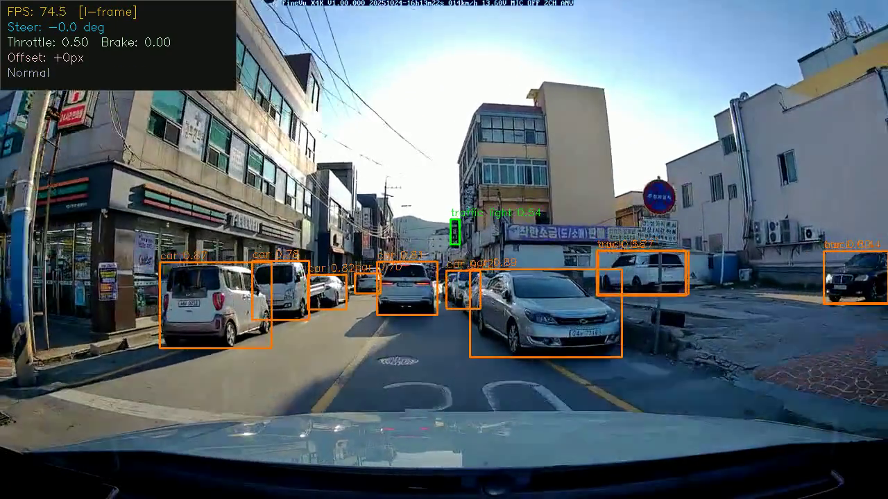

# OL-SCS: 객체 수준 장면 변화 점수 기반 I/P 추론 스케줄링

암갈란투르 (21101198) · 서울과학기술대학교
지도교수: 김성곤 · 2026-10-30

> 발표 5분: 이전 프로젝트 1분 → OL-SCS 1분 → 실험 결과 2분 → 결론 1분
> 각 슬라이드 아래 `Note`는 발표 대본. Marp로 열면 슬라이드로 보인다.

---

## 1. 이전 프로젝트: Frame-level SCS  `(1분)`

**아이디어 — 비디오 코덱의 I/P-frame을 추론에 적용**
- **I-frame**: YOLOv5s 전체 추론 (약 15–19 ms)
- **P-frame**: 직전 탐지 결과 재사용 (1 ms 미만)

**판정식 (프레임 전체 기준)**
```
SCS = 0.6 · Δpixel + 0.4 · (1 − conf)      SCS ≥ 0.35 → I-frame
Δpixel = 프레임 전체 평균 밝기 차분,  연속 P-frame 최대 4
```

**문제점**
- 평균 밝기 차분은 **작은 객체의 움직임이 평균에 묻힌다**
- 실제 측정: 영상 4편 모두 I 비율 **0.200** → 임계값을 거의 못 넘고 **5프레임 고정 간격처럼 동작**

> Note: 캡스톤에서는 코덱의 I/P 구조를 그대로 가져와 장면이 바뀐 프레임만 추론했습니다.
> 그런데 프레임 전체 평균을 쓰다 보니, 화면 일부를 차지하는 차량이 움직여도 점수가 거의 안 올라갑니다.
> 결국 네 영상 모두 I 비율이 정확히 0.2, 즉 P-frame 상한 때문에 5프레임마다 추론하는 고정 간격과 같았습니다.

---

<style scoped>
section { font-size: 19px; padding: 40px 40px; }
h2 { font-size: 32px; margin-bottom: 8px; }
pre { font-size: 14px; }
table { font-size: 16px; }
blockquote { font-size: 14px; }
</style>



## 2. 이번 프로젝트: OL-SCS  `(1분)`

**판정 단위를 프레임 → 객체로**
```
OL-SCS_i = (0.6 + 0.4 · (1 − conf_i)) · Δpixel_i      하나라도 ≥ 0.25 → I-frame
Δpixel_i = 객체 박스(+20% 패딩) 안 변화 픽셀 비율
```

**I-frame 조건 (하나라도 만족하면 추론)**
| 조건 | 역할 |
|---|---|
| 객체 움직임 OL-SCS_i ≥ 0.25 | 기존 객체가 움직임 |
| 객체 재사용 한도 (새 객체 4 → 안정 객체 최대 8프레임) | 오래된 결과 갱신 |
| 배경 변화 (8×6 그리드, 셀 최댓값 ≥ 0.15) | 새 객체 진입 감지 |
| 15프레임 강제 주기 | 안전장치 |

- 판정은 폭 160 px 축소 영상에서 수행

> Note: 객체마다 박스 안에서 변한 픽셀 비율을 보고, 신뢰도가 낮은 객체는 더 민감하게 반응하게 했습니다.
> 객체 판정만으로는 새로 들어오는 객체를 못 잡기 때문에 배경 그리드 변화도 같이 봅니다.

---

## 3-1. 실험 설정  `(2분 중 30초)`

- **환경**: RTX 4060, YOLOv5s (PyTorch), 1280×720
- **데이터**: YouTube 공개 영상 4편, 16,822프레임 (파라미터 조정에 사용 안 함)
  - dashcam (주간 도심) · highspeed (랠리, 50 FPS) · lowlight (야간) · crowd (교차로 고정 카메라)
- **정확도 기준**: 매 프레임 YOLOv5s 추론 결과 (스케줄링으로 잃는 정확도만 측정)
- **비교 대상 3개**
  1. Frame-level SCS (이전)
  2. OL-SCS (제안)
  3. **고정 간격** — OL-SCS와 **I-frame 수를 똑같이 맞춘** 균등 배치 기준선

> Note: 세 번째 기준선이 핵심입니다. 추론 횟수를 똑같이 맞추면, OL-SCS가 '언제 추론할지'를 잘 고르는지만 따로 볼 수 있습니다.

---

## 3-2. 결과 ①: 이전 기법 대비  `(40초)`

| 영상 | 방식 | I 비율 | Recall | 속도비 |
|---|---|---:|---:|---:|
| dashcam | Frame-level SCS | 0.200 | 0.845 | 1.00 |
| | OL-SCS | 0.371 | **0.916** | 0.54 |
| highspeed | Frame-level SCS | 0.201 | **0.628** | 1.00 |
| | OL-SCS | 0.132 | 0.563 | **1.30** |
| lowlight | Frame-level SCS | 0.200 | **0.941** | 1.00 |
| | OL-SCS | 0.134 | 0.927 | **1.28** |
| crowd | Frame-level SCS | 0.200 | 0.771 | 1.00 |
| | OL-SCS | 0.536 | **0.929** | 0.36 |

- OL-SCS는 장면에 따라 I 비율을 **0.132–0.536**으로 조절
- 객체 많은 장면 → 정확도 ↑ 속도 ↓ / 객체 적은 장면 → 속도 ↑ 정확도 ↓

> Note: 이전 기법과만 비교하면 장면에 따라 정확도나 속도 중 하나가 좋아집니다. 하지만 이게 I-frame을 잘 골라서인지, 단지 많이/적게 써서인지는 이 표로는 알 수 없습니다.

---

## 3-3. 결과 ②: 같은 I 비율의 고정 간격 대비  `(50초)` ★

**OL-SCS − 고정 간격** (I-frame 수 동일)

| 영상 | I 비율 | ΔRecall | ΔPrecision | 속도 (OL-SCS / 고정) |
|---|---:|---:|---:|---:|
| dashcam | 0.371 | −0.1%p | +0.2%p | 0.88 |
| highspeed | 0.132 | +0.1%p | −1.1%p | 0.79 |
| lowlight | 0.134 | +0.1%p | +0.8%p | 0.76 |
| crowd | 0.536 | +0.3%p | +0.4%p | 0.91 |

- **정확도: 차이 없음** (recall ±0.3%p 이내)
- **속도: OL-SCS가 9–24% 느림**
- 원인: P-frame 판정 비용 **OL-SCS 0.56–0.76 ms** vs **고정 간격 0.03–0.05 ms**

> Note: 이번 발표에서 가장 중요한 표입니다. 추론 횟수를 맞추면 정확도는 똑같고, OL-SCS는 판정 계산 때문에 오히려 느립니다.
> 즉 앞 표의 정확도 차이는 전부 I-frame 개수 차이에서 나온 것입니다.

---

## 4. 결론 및 향후 과제  `(1분)`

**결론**
- ✅ OL-SCS는 적정 추론 간격을 몰라도 **장면에 맞춰 추론 횟수를 자동 결정** (I 비율 0.132–0.536)
- ❌ 같은 추론 횟수에서는 고정 간격과 **정확도 동일, 속도 9–24% 느림**
- → 효과는 "**언제** 추론할지"가 아니라 "**몇 번** 추론할지"에서 나옴
- I 비율을 맞춘 기준선이 없었다면 놓쳤을 결과

**향후 과제**
1. **판정 경량화** — 몇 프레임마다 판정, 객체 패치 차분 배치 처리, 판정 해상도 축소
   → 목표: P-frame 비용을 고정 간격 수준(~0.05 ms)으로
2. **검증 확대** — 사람 라벨 데이터셋, 더 긴 영상, 다른 탐지기·하드웨어
3. **P-frame 갱신** — 결과 재사용 대신 경량 추적으로 박스 위치 보정

> Note: 정리하면, OL-SCS는 장면별로 추론량을 정하는 데는 의미가 있지만, 지금은 판정 비용 때문에 같은 추론 횟수의 고정 간격보다 느립니다.
> 다음 단계는 판정 비용을 고정 간격 수준으로 낮추는 것입니다. 감사합니다.
